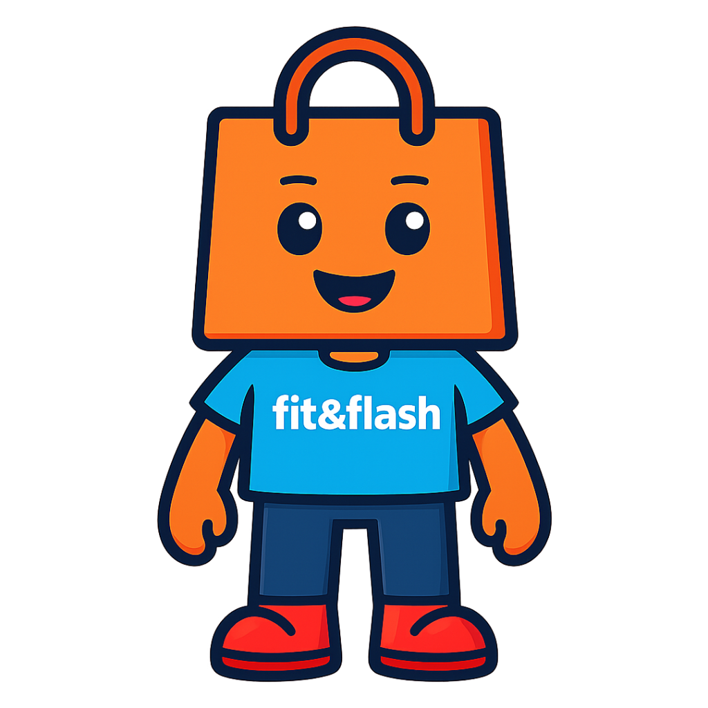
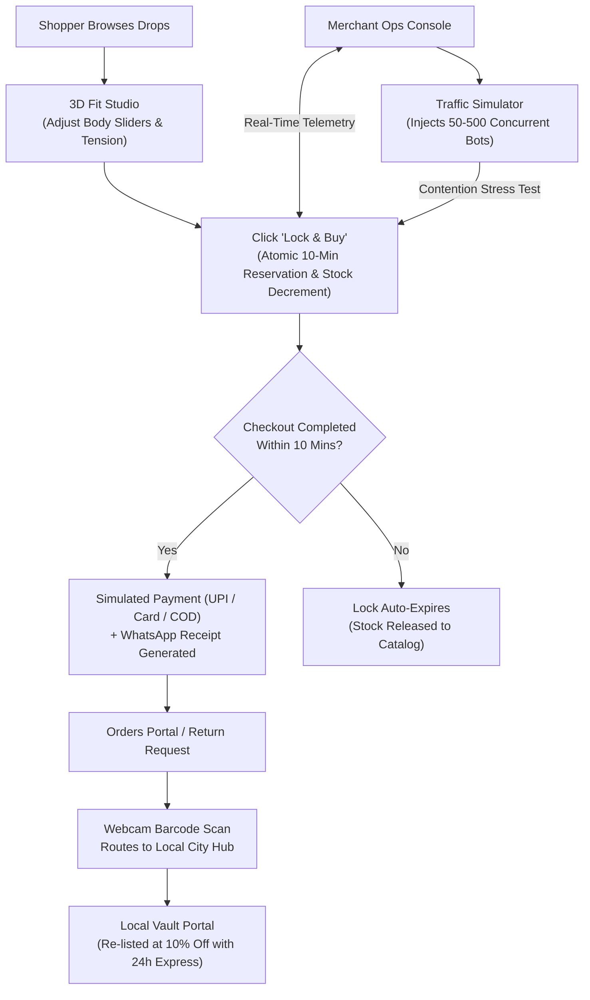

# Fit&Flash

> High-concurrency D2C streetwear flash-sale platform featuring real-time 3D fit visualization, atomic stock locks, and hyperlocal 24-hour return routing.

---

## Overview

**Fit&Flash** is a high-concurrency D2C e-commerce platform built to solve the most critical pain points in limited-quantity streetwear drops: bot sniping, cart overselling, sizing uncertainty, and slow multi-day returns. Built for fashion consumers seeking limited drops with sizing confidence and merchants managing flash inventories, the platform pairs an interactive 3D Fit Studio with an atomic zero-oversell reservation engine. Shoppers can test real body measurements against garment wireframes, lock inventory for 10 minutes during checkout, and route returns to local city hubs within 24 hours. The application operates entirely out of the box with zero external backend dependencies using local-first state persistence and an integrated merchant traffic simulator.

---

## Preview

<div align="center">
  
  <p>
    <a href="https://fit-flash.vercel.app/" target="_blank"><strong>🌐 View Live Deployment: https://fit-flash.vercel.app/</strong></a>
  </p>
</div>

> **Live Deployment:** [https://fit-flash.vercel.app/](https://fit-flash.vercel.app/)  
> **Local Development:** Run `npm run dev` to access locally at `http://localhost:3000`.

### 🎬 Product Demo Video

<!-- Tip: Store your demo video in public/demo.mp4 or embed it directly below -->
https://www.veed.io/view/da97a094-63b6-4fa2-8742-1860756325e1?panel=share

> *Watch how the 3D Fit Studio, 10-minute atomic stock reservation, and Local Vault return workflow operate in real-time.*
---

## Key Features

- **Interactive 3D Fit Studio:** Manipulate body sliders (chest, waist, height, foot dimensions) with real-time Three.js mesh morphing and tension heatmaps.
- **10-Minute Zero-Oversell Stock Locks:** Reserves drop inventory atomically upon clicking "Lock & Buy" with a live sticky countdown timer.
- **Hyperlocal "Local Vault" Hubs:** Routes verified returns to metro hubs (Bengaluru, Mumbai, Delhi NCR) for express 24-hour re-delivery at a 10% discount.
- **Simulated Indian Payment Stack:** Instant UPI QR generation (GPay/PhonePe), tokenized card inputs, and Cash on Delivery with OTP verification.
- **Automated WhatsApp Order Updates:** Slide-over notification drawer delivering instant order receipts and tracking codes upon checkout.
- **Webcam Security Tag Scanner:** Built-in scanner interface simulating barcode and RFID tag verification for instant return authorization.
- **Merchant Ops Console & Traffic Simulator:** Real-time KPI telemetry (active locks, drop-off, revenue) with a background bot generator simulating 50 to 500+ concurrent shoppers.
- **Dual-Role Session Switcher:** Seamlessly toggle between Shopper (A/B) and Merchant roles with synchronized persistent state.

---

## Tech Stack

| Category | Technologies |
|---|---|
| **Framework & Runtime** | [Next.js 14](https://nextjs.org/) (App Router), [React 18](https://react.dev/), [Node.js](https://nodejs.org/) |
| **Language** | [TypeScript](https://www.typescriptlang.org/) |
| **3D Graphics & Physics** | [Three.js](https://threejs.org/) (WebGL 3D Grid Floor & Garment Wireframe Mesh) |
| **Styling & Icons** | [Tailwind CSS](https://tailwindcss.com/), [Lucide React](https://lucide.dev/), [Canvas Confetti](https://www.npmjs.com/package/canvas-confetti) |
| **State & Concurrency** | React Context API with Local-First `localStorage` Atomic Persistence |

---

## Getting Started

### Prerequisites

- **Node.js**: Version `18.17.0` or higher (Node 20+ recommended)
- **Package Manager**: `npm` (bundled with Node.js), `pnpm`, or `yarn`
- **Web Browser**: Any modern browser supporting WebGL (Chrome, Edge, Safari, Firefox)

### Installation

1. **Clone the repository:**
   ```bash
   git clone <repository-url>
   cd fit-and-flash
   ```

2. **Install dependencies:**
   ```bash
   npm install
   ```

3. **Configure environment variables:**
   > **Note:** Fit&Flash runs completely out of the box using client-side atomic state persistence. No external database keys, cloud accounts, or environment variables are required.

4. **Start the development server:**
   ```bash
   npm run dev
   ```

5. Open [http://localhost:3000](http://localhost:3000) in your browser.

### Production Build

To build and run the optimized production bundle:
```bash
npm run build
npm run start
```

---

## Project Structure

```text
fit-and-flash/
├── app/
│   ├── globals.css              # Tailwind base styles and custom animations
│   ├── layout.tsx               # Root HTML layout and font configurations
│   └── page.tsx                 # Main application view and screen router
├── components/
│   ├── 3d/
│   │   └── FitStudioCanvas.tsx  # Three.js 3D garment mesh rendering canvas
│   ├── checkout/
│   │   ├── CheckoutDrawer.tsx   # 10-minute cart lock banner & payment tabs
│   │   └── WhatsAppNotification.tsx # Post-purchase slide-over notification
│   ├── hero/
│   │   ├── HeroGridBackground.tsx # Interactive WebGL synthwave grid floor
│   │   └── ImmersiveHero.tsx    # 100vh scrollytelling hero section
│   ├── mascot/
│   │   └── AnimatedMascot.tsx   # Brand mascot with jump physics and shadow
│   ├── merchant/
│   │   └── MerchantConsole.tsx  # Telemetry dashboard & live traffic simulator
│   ├── orders/
│   │   ├── OrdersSection.tsx    # Order history and return tracking view
│   │   └── ReturnTagScanModal.tsx # Webcam security tag barcode scanner
│   ├── storefront/
│   │   ├── BrandStory.tsx       # Architectural exhibition narrative section
│   │   ├── FitStudioModal.tsx   # 3D body dimension sliders & tension gauge
│   │   └── ProductCard.tsx      # Drop exhibition card with stock urgency
│   ├── ui/
│   │   ├── AuthModal.tsx        # Shopper/Merchant dual-role authentication
│   │   ├── Footer.tsx           # Global footer band
│   │   ├── Header.tsx           # Navigation bar with live cart lock badge
│   │   └── ToastContainer.tsx   # Real-time event notifications
│   └── vault/
│       └── LocalVaultSection.tsx # 24h city hub verified returns portal
├── context/
│   └── AppContext.tsx           # Atomic concurrency engine & local storage store
├── data/
│   └── initialProducts.ts       # Curated streetwear drops catalog data
├── docs/                        # PRD, Architecture, and Design System docs
├── public/
│   └── logo.png                 # Brand logo and mascot emblem
├── tailwind.config.ts           # Design tokens, custom colors, and typography
└── tsconfig.json                # Strict TypeScript configuration
```

---

## How It Works



1. **Browsing & 3D Fitting:** Shoppers explore limited drops and customize sizing using the interactive Three.js 3D Fit Studio to preview tension zones before purchase.
2. **Atomic Inventory Locking:** Initiating checkout locks the item atomically for 10 minutes, preventing race conditions and cart sniping.
3. **Frictionless Settlement:** Payments are simulated via dynamic UPI QR, card tokenization, or COD with OTP verification, triggering an automated WhatsApp receipt.
4. **Hyperlocal Reverse Logistics:** Returns are scanned via webcam barcode verification and routed to local metro hubs (Bengaluru, Mumbai, Delhi NCR) for express 24h re-delivery at a 10% discount.
5. **Merchant Telemetry & Simulation:** Merchants monitor live concurrency metrics and can stress-test inventory contention using the built-in bot traffic generator.

---

## Future Improvements

- **Live Payment Gateway Integration:** Connect production payment processors such as Razorpay or Cashfree.
- **Logistics Carrier Webhooks:** Integrate live shipping and courier tracking APIs (e.g., Delhivery, Shiprocket).
- **Multi-Tenant Cloud Persistence:** Transition local-first storage to a distributed backend (PostgreSQL + Redis lock manager).
- **Photogrammetric AI Body Scanning:** Mobile camera scanning to auto-populate 3D body dimension sliders.

---

## Author & License

- **Project:** Fit&Flash D2C Streetwear Atelier
- **License:** Private / Proprietary
