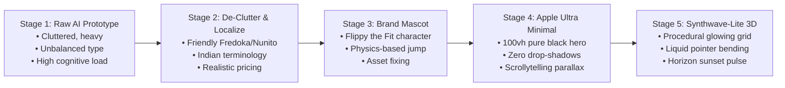

# Fit&Flash — Product Background & Full UX/UI Evolution Summary (A to Z)

---

## 1. Executive Summary & Product Background

**Fit&Flash** is a high-concurrency D2C streetwear flash-sale and e-commerce platform built specifically to solve the biggest pain points in modern sneaker and streetwear drops: **bot sniping, cart overselling, sizing uncertainty, and delayed return cycles**.

### The Core Problem in Streetwear Commerce
1. **The Oversell / Bot Crisis:** Limited-quantity drops sell out in milliseconds. Conventional e-commerce carts do not reserve inventory until payment succeeds, causing thousands of shoppers to suffer checkout failures, duplicate charges, or cart sniping.
2. **The 30–40% Return Dilemma:** Streetwear fits vary dramatically between brands (boxy tees, stacked denim, oversized hoodies). Sizing guesswork causes return rates exceeding 35%, generating high return logistics costs and tying up inventory for weeks.
3. **The 7-Day Return Friction:** Traditional returns require warehouse transit, manual QC inspection, and 5–7 days before refunds or inventory restocks occur.

### The Fit&Flash Solution
Fit&Flash merges **high-concurrency atomic stock locking**, **real-time 3D fit visualization**, **hyperlocal 24-hour return routing (Local Vault)**, and **instant Indian payments (UPI / COD)** into a cohesive, retro-futuristic digital flagship store.

---

## 2. Core Architectural & Feature Pillars

| Pillar | Technical Mechanism | User Value |
|---|---|---|
| **1. 10-Minute Zero-Oversell Cart Lock** | Atomic state lock with timestamped decrement (`$inc: -1`) and automatic release worker. | When a shopper clicks "Lock & Buy", that exact item is 100% held for 10 minutes. Zero bot sniping, zero overselling anxiety. |
| **2. 3D Smart Fit Studio** | Interactive Three.js viewport with real-time mesh morphing, body dimension sliders, and tension heatmaps. | Allows shoppers to test real chest/waist/foot dimensions against garment cuts before buying, drastically cutting returns. |
| **3. Hyperlocal "Local Vault"** | Local vendor city hub routing across Indian metros (Bengaluru, Mumbai, Delhi NCR). | Shoppers return items to nearby verified local hubs in 24 hours. Items are verified via barcode scanning and re-listed at a 10% hub discount with express 24h delivery. |
| **4. Indian Payment & WhatsApp Stack** | Real-time UPI QR (GPay/PhonePe), Cash on Delivery with OTP verification, and automated WhatsApp drawer notifications. | Instant payment frictionless for Indian consumers with transparent post-purchase tracking. |
| **5. Merchant Ops Console & Traffic Simulator** | Live merchant telemetry dashboard with built-in high-concurrency bot/shopper traffic generator and return QC queue. | Merchants can stress-test stock contention, observe real-time lock releases, and approve incoming hub returns. |

---

## 3. Step-by-Step UI/UX Evolution: From Raw Prototype to Polished Product

The design and user experience of Fit&Flash underwent five distinct evolutionary stages to eliminate "AI slop", achieve razor-sharp visual hierarchy, and deliver an Apple-grade scrollytelling experience.



---

### Stage 1: The Raw Prototype & Identifying "AI Slop"
- **Initial State:** The functional features worked, but the visual interface suffered from classic AI-generated design fatigue:
  - Aggressive neon glows, redundant borders, and stacked cards fighting for attention.
  - Headings were excessively large and loud, dominating the viewport.
  - Complex, lengthy product names ("Kabukicho Hyper-Cyberpunk Acid Tee") that felt artificial.
  - Generic demo users with stock portrait photos that distracted from the clothing.
- **Key Decision:** Strip away non-functional decorative noise. Prioritize clean product photography, clear typography, and a calmer, more confident streetwear aesthetic.

---

### Stage 2: Typography Normalization & Indian Consumer Localization
- **Typography Scale:** Normalized to a balanced pairing:
  - **Headings:** `Fredoka` font, sized between 28px and 48px with tight, disciplined line-height.
  - **Body / Technical Specs:** `Nunito` font at 14px–16px, ensuring comfortable readability.
  - **Monospace Accents:** `JetBrains Mono` for timers, stock telemetry, and SKU identifiers.
- **Indian Market Localization:**
  - Jargon like *"Decentralized Reverse Logistics"* was replaced with **"Local Vault: 24hr City Hub Returns (Bengaluru, Mumbai, Delhi NCR)"**.
  - Demo personas were updated to authentic, clean identities (e.g., Aarav Sharma – Indiranagar, Bengaluru; Rohan Mehta – Bandra, Mumbai).
  - Product catalog prices were adjusted upwards of ₹2,000–₹3,000 (ranging from ₹2,199 to ₹4,799) to accurately reflect premium luxury streetwear.
  - Payment options were simplified to **Instant UPI QR (GPay / PhonePe / Paytm)** and **Cash on Delivery with OTP verification**.

---

### Stage 3: Introducing the Brand Mascot & Asset Verification
- **Official Mascot ("Flippy"):** The official shopping bag character was introduced as the friendly face of Fit&Flash.
- **Single Jump Physics:** Rather than overwhelming users with multiple gimmicky buttons ("Dance", "Wave", "Vibe"), the mascot was refined to a single continuous, fluid jump animation:
  - Custom CSS/Canvas keyframes with squash-and-stretch physics (`mascot-jump-smooth`).
  - Natural blinking eyelids triggering every 3.5 to 5.5 seconds.
  - Synchronized ground contact shadow scaling (`mascot-shadow-jump`).
- **Asset Quality Audit:** Fixed broken external image assets (notably the Okayama 18oz Selvedge Denim, which was replaced with a verified 200 OK 4K raw denim asset).

---

### Stage 4: The Apple Watch Ultra Minimalist Shift (Scrollytelling & 100vh Hero)
Inspired by the Apple Watch Ultra design specification (`apple-watch-ultra-4-design-md.md`):
- **100vh Full-Bleed Hero Canvas:** Full-viewport hero staging with the jumping mascot dead-center. Zero distracting sidebars or split-column clutter.
- **Brand Lockup & Display Typography:**
  - Crisp micro-brand lockup: `FIT&FLASH` with the mascot emblem.
  - All-caps display statement: **`"A DROP YOU CAN'T OUTRUN."`** set with tight letter tracking.
- **Apple Purchase Stack:**
  - **Purchase Blue (`#0071e3`)** pill button: `"Explore Drops"` with smooth scrolling into the catalog bays.
  - Direct pricing & finance copy: `"From ₹2,199 or ₹183/mo. for 12 mo.*"`
  - Guarantee subtitle: `"10-Minute Zero-Oversell Cart Lock • 24hr Local City Hub Returns"`
- **Strict Elevation Discipline:**
  - **Zero box-shadows or artificial drop-shadows** on product cards.
  - Depth is created purely through canvas contrast: Absolute Black (`#000000`) hero stage transitioning into Carbon (`#111111`) section bands.
  - All product media tiles use a uniform **28px border radius** (`rounded-[28px]`).
- **Scroll-Driven Parallax (Scrollytelling):**
  - As the user scrolls down, the headline and purchase stack softly translate upward and fade.
  - The mascot translates with vertical parallax depth before gliding into the exhibition catalog section.

---

### Stage 5: The "Synthwave-Lite" 3D Interactive Grid Floor
To elevate the hero section from a flat black void into a tactile, retro-futuristic streetwear world, an interactive 3D WebGL grid floor was engineered using Three.js:
- **Procedural Glowing Grid Floor:**
  - An infinite electric blue (`#1AA3FF`) grid plane stretching from the bottom of the viewport to the horizon line at ~56% viewport height.
  - Seamless forward scrolling at 0.6 units/sec calculated via `fract()` modulo UV offsets (zero seam or pop).
  - Dual-lobe line shader: ultra-crisp line core plus a soft bloom-like glow, fading into deep black at the horizon via distance fog.
- **Horizon Sunset Orb & Haze:**
  - Positioned behind the mascot at the horizon: a soft radial sunset gradient (incandescent orange `#FFA04D` -> saturated orange `#FF5500` -> magenta rim `#B81473`).
  - Subtle 6-second breathing pulse (scale 1.0 -> 1.04).
  - Horizontal atmospheric haze band blending the warm sunset into the cool blue grid.
- **Liquid Pointer Interaction (Gaussian Bump):**
  - Moving the cursor over the hero raycasts to the 3D ground plane.
  - Vertices displace dynamically with a Gaussian bump (`radius: 2.5`, `amplitude: 0.65`) smoothed via a frame lerp (`0.08`), creating a responsive liquid wave feel.
  - Grid lines near the bump peak brighten and shift their color from blue to brand orange (`#FF7A1A`).
  - When the cursor leaves the hero, the bump relaxes smoothly back to flat.
- **Subtle Atmosphere:**
  - Drifting dust particles (80 tiny orange and blue motes floating upward).
  - Subtle pointer camera parallax (+/- 1.8° tilt).
  - 4% opacity retro film grain overlay.
- **Guaranteed Contrast & Grounding:**
  - Soft dark radial vignette behind the headline to guarantee AA contrast compliance (white text on dark).
  - Soft blurred elliptical contact shadow with an orange rim glow under the mascot's feet in CSS, grounding the character firmly onto the 3D grid.

---

## 4. Complete Screen-by-Screen Feature Walkthrough

### 1. Storefront & Drop Catalog (`app/page.tsx`)
- **Header Navigation (44px Global Bar):** Mascot logo, category links, Local Vault portal, My Orders, and active Cart Lock countdown badge.
- **Interactive Hero:** The 100vh synthwave-lite 3D grid with the jumping mascot, Apple headline, and Explore Drops CTA.
- **Curated Exhibition Bays:** 28px rounded media tiles displaying limited streetwear drops with high-res photography, price tags (₹2,199 – ₹4,799), remaining stock counters (`"Only 3 left"`), and instant action buttons (`"Try 3D Fit"` / `"Lock & Buy"`).
- **Category Filter Pills:** All Drops, Luxury T-Shirts, Heavyweight Hoodies, Designer Shirts, Japanese Denim, and Limited Sneakers.

### 2. Interactive 3D Fit Studio (`components/storefront/FitStudioModal.tsx`)
- **Three.js Viewport:** 3D garment wireframe that users can freely rotate, inspect, and pan.
- **Garment & Shoe Sizing:** S, M, L, XL, XXL (or UK 7–11 for sneakers).
- **Body Dimension Sliders:**
  - *Tops/Bottoms:* Chest (80–130 cm), Waist (60–115 cm), Height (150–205 cm).
  - *Sneakers:* Foot Length (24–31 cm), Width (Narrow, Regular, Wide), Arch Height.
- **Real-Time Mesh Morphing & Tension Heatmaps:** Moving sliders morphs the 3D geometry in real-time, accompanied by tension indicators (Green = Ideal 96% Match, Orange = Tight Fit, Red = Severe Contraction).

### 3. 10-Minute Cart Lock & Checkout (`components/checkout/CheckoutDrawer.tsx`)
- **Atomic Stock Lock:** Clicking "Lock & Buy" reserves 1 unit from inventory with a live 10:00 countdown timer.
- **Zero-Oversell Guarantee:** If the timer reaches 00:00 without checkout completion, the unit is automatically restored to the public pool and the user is gently notified.
- **Payment Methods:**
  - **Instant UPI QR:** Generates a real UPI intent QR code compatible with GPay, PhonePe, and Paytm.
  - **Credit / Debit Cards:** Simulated card verification with bank-grade security badges.
  - **Cash on Delivery (COD):** Protected by an instant OTP SMS verification modal.

### 4. Automated WhatsApp Post-Purchase Updates (`components/checkout/WhatsAppNotification.tsx`)
- Interactive bottom drawer simulating real-time WhatsApp Business message notifications.
- Delivers order confirmation, tracking IDs, local city hub dispatch times, and direct 1-click return links.

### 5. Local Vault & 24-Hour Return Routing (`components/vault/LocalVaultSection.tsx`)
- **Return Drop-Off Hubs:** Dedicated hubs in Bengaluru (Indiranagar / Koramangala), Mumbai (Bandra West), and Delhi NCR (Cyber Hub Gurgaon).
- **Express Re-Dispatch:** Returns inspected at local hubs are immediately made available to nearby shoppers with a **"10% Local Hub Discount"** and **"Express 24h Delivery"** badge.
- **Return Tag Scanner (`components/orders/ReturnTagScanModal.tsx`):** Shoppers or hub staff can scan the item's return security tag via webcam barcode emulation for instant return authorization.

### 6. Merchant Ops Console & Traffic Simulator (`components/merchant/MerchantConsole.tsx`)
- **Dual-Role Switcher:** Switch seamlessly between Shopper view and Merchant Operations.
- **High-Concurrency Traffic Simulator:** Inject simulated concurrent traffic (10 to 500+ virtual shoppers/bots) to observe real-time stock lock contention, cart expiration releases, and sold-out triggers.
- **Merchant Inventory Telemetry:** Real-time metrics tracking locked inventory, active drops, and local hub returns pending inspection.

---

## 5. Technical Highlights & Performance Engineering

```
┌─────────────────────────────────────────────────────────────┐
│                 Fit&Flash Tech Stack                        │
├───────────────────────┬─────────────────────────────────────┤
│ Framework             │ Next.js 14 (App Router)             │
│ Language              │ TypeScript 5 (Strict Mode)          │
│ Styling               │ Tailwind CSS (Custom Apple Tokens)  │
│ 3D Rendering          │ Three.js 0.169 (Custom GLSL Shaders)│
│ State Management      │ Local-First Persisted Store         │
│ Icons & Polish        │ Lucide React, CSS Hardware Canvas   │
└───────────────────────┴─────────────────────────────────────┘
```

1. **Client-Only 3D Dynamic Import:** Three.js components are loaded via `next/dynamic(..., { ssr: false })` to eliminate SSR hydration mismatches.
2. **GPU Optimization:**
   - Custom single-pass vertex & fragment shaders (no expensive post-processing bloom passes; bloom is simulated mathematically via dual-lobe line width equations).
   - Pixel ratio capped at `min(window.devicePixelRatio, 2)`.
   - Reduced geometry subdivisions on mobile viewports (<768px: 60x60 segments; desktop: 120x120 segments).
3. **Battery & Tab Resource Protection:**
   - `IntersectionObserver`: Pauses the WebGL render loop when the hero scrolls out of view.
   - `document.visibilitychange`: Immediately suspends animation frames when the user switches browser tabs.
4. **Accessibility & Graceful Degradation:**
   - `prefers-reduced-motion`: Automatically switches to a static single-frame render without motion or pulsing.
   - Non-WebGL Fallback: Automatic fallback to a pure CSS perspective grid with radial sunset gradient if WebGL is unsupported.

---

## 6. How to Tune Visual Intensity (`HERO_GRID_CONFIG`)

All visual, motion, and interaction parameters are exposed at the very top of `components/hero/HeroGridBackground.tsx`:

```ts
export const HERO_GRID_CONFIG = {
  // Palette
  gridColor: '#1AA3FF',       // Grid line color (electric blue)
  accentColor: '#FF7A1A',     // Liquid displacement highlight (brand orange)
  
  // Motion
  scrollSpeed: 0.60,          // Grid forward speed (calm baseline)
  
  // Interaction
  bendRadius: 2.5,            // Spread radius of the cursor deformation
  bendStrength: 0.65,         // Height of the liquid bump
  bendLerp: 0.08,             // Liquid easing responsiveness
  
  // Particles
  particleCount: 80,          // Number of floating dust motes
};
```

- **For an Ultra-Subtle / Understated Look:** Set `bendStrength: 0.35`, `glowWidth: 0.10`, and `particleCount: 30`.
- **For a Louder / High-Energy Synthwave Vibe:** Set `bendStrength: 1.10`, `glowWidth: 0.28`, and `scrollSpeed: 1.0`.

---

## 7. Current Project Status

- **Development Server:** Live and running on `http://localhost:3000`.
- **Build Status:** Verified passing `next build` (4/4 static routes generated with 0 errors).
- **All Core Journeys Functional:** Browsing, 3D Fit Studio, 10-minute stock locks, checkout simulation, WhatsApp alerts, Local Vault routing, and Merchant traffic simulator are fully interactive and persistent.

---

## 8. Universal Quick-Start Guide (How to Run in Any Folder)

Anyone accessing this repository online or downloading it as a ZIP can run the platform locally in three simple steps:

### Prerequisites
- **Node.js:** v18.17.0+ or v20+ (`node -v`)
- **Package Manager:** `npm` (bundled with Node), `pnpm`, or `yarn`
- **Environment:** No `.env` or external database needed! State is stored locally via client-side atomic persistence.

### Terminal Commands

```bash
# Step 1: Clone or extract into any folder
git clone <REPOSITORY_URL>
cd fit-and-flash

# Step 2: Install dependencies
npm install

# Step 3: Start the development server
npm run dev
```

Open **`http://localhost:3000`** in any web browser.

### For Production Performance:
```bash
npm run build
npm run start
```


